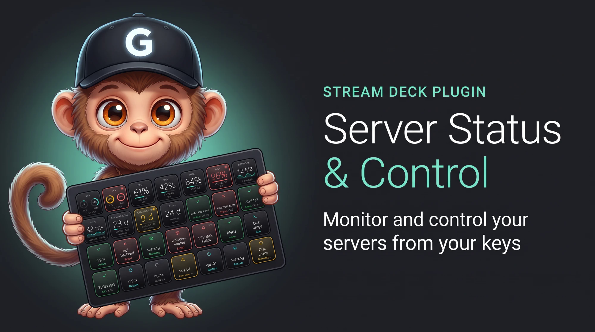
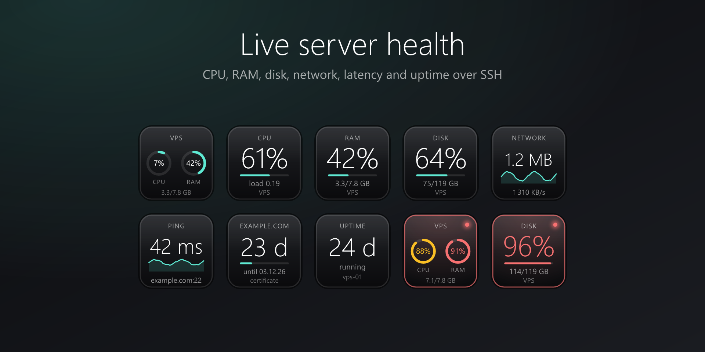
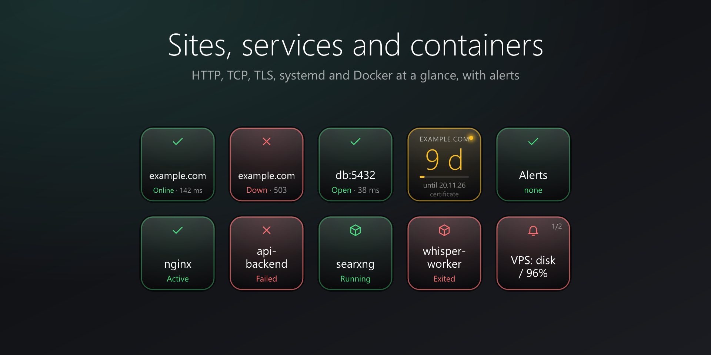
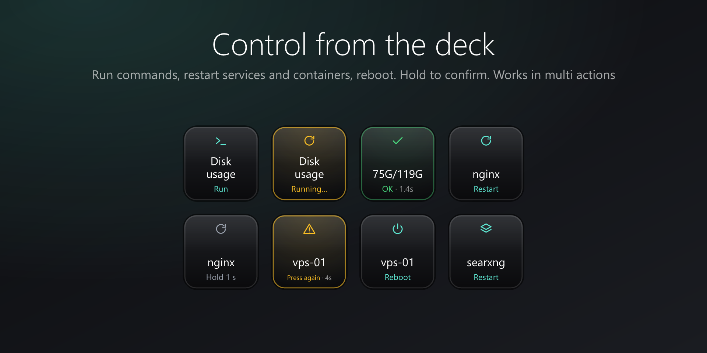
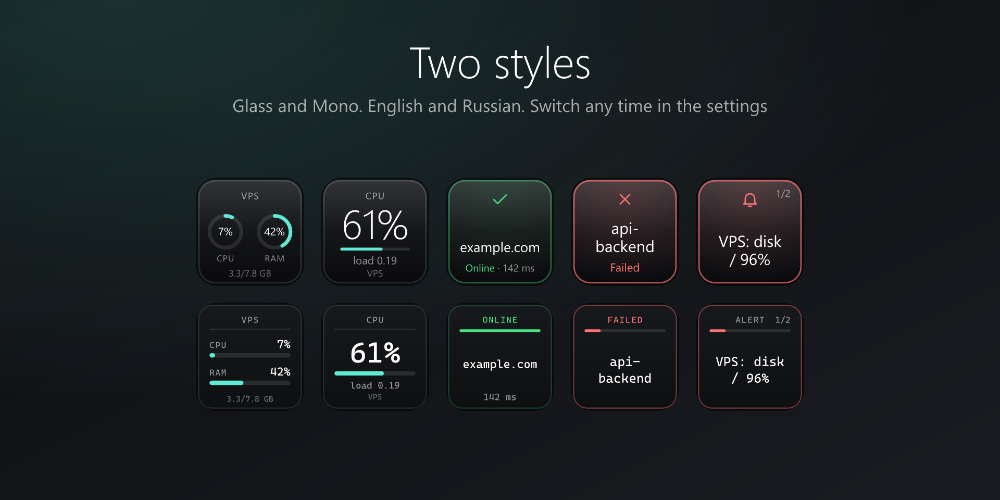

<div align="center">



<br>

🌐 **English** &nbsp;·&nbsp; [Русский](README.ru.md)

<br>

[](LICENSE)
[](https://www.elgato.com/stream-deck)
[](#requirements)
[](#privacy-and-safety)

**See your servers at a glance. Fix them with one press.**<br>
CPU, RAM, disk, network, websites, TLS certificates, services, Docker, alerts, and safe control actions, right on your keys.

[Quick start](#quick-start) · [Actions](#actions) · [Safety](#privacy-and-safety) · [Troubleshooting](#troubleshooting) · [Issues](https://github.com/TheGudwinn/streamdeck-server-status-control/issues)

</div>

---

## Why this plugin

<table>
<tr>
<td width="50%" valign="top">

### 👀 Monitor
- CPU, RAM, swap, load, disk, network, uptime
- Website, port and TLS-certificate checks
- systemd services and Docker containers
- One **Alert Hub** key that blinks until you acknowledge

</td>
<td width="50%" valign="top">

### 🛠 Control
- Run commands or ready-made presets
- Restart, start, stop services and containers
- Reload nginx **after testing the config**
- Reboot with a double confirmation
- Everything works inside **multi actions**

</td>
</tr>
<tr>
<td valign="top">

### 🔌 Nothing to install on the server
Uses the `ssh` client already on your computer and your `~/.ssh/config`. No agents, no accounts, no API keys.

</td>
<td valign="top">

### 🎨 Made to look good
Two key styles (**Glass** and **Mono**), English and Russian, solid and readable at a glance.

</td>
</tr>
</table>

## Screenshots

<table>
<tr>
<td></td>
<td></td>
</tr>
<tr>
<td></td>
<td></td>
</tr>
</table>

## Actions

| | Action | What it does |
|:-:|---|---|
| 🖥 | **Host Overview** | CPU and RAM of a server on one key |
| 📊 | **Metric** | CPU, RAM, swap, load, disk, network, uptime, with a graph where it helps |
| 📡 | **Latency** | TCP connect time with history |
| 🌐 | **HTTP Check** | status code, response time, optional keyword on the page |
| 🔌 | **TCP Port** | is the port open |
| 🔒 | **TLS Expiry** | days until the certificate expires |
| ⚙️ | **systemd Unit** | state of a service, optional hold-to-restart |
| 📦 | **Docker Container** | state of a container, optional hold-to-restart |
| 🔔 | **Alert Hub** / **Acknowledge** | shared alert key and a key to acknowledge |
| ⌨️ | **Run Command** | run a command or a preset, result on the key |
| ⏻ | **Power** | reboot or shut down: hold 1.5 s, then press again |
| 🔄 | **Service Control** | `systemctl` restart / start / stop / reload |
| 🧱 | **Docker Control** | `docker` restart / start / stop |

> HTTP Check, TCP Port, Latency and TLS Expiry work without SSH. Everything else needs SSH access to a Linux server.

### Command presets

Uptime · Disk usage · Top process · Errors in the last 10 min · nginx test · **nginx reload** (tests the config first) · Docker running · Free cache

## Quick start

### Requirements

- Windows 10 or later and Stream Deck 7.1 or later (macOS has not been tested)
- For server features: key-based SSH login to a Linux server. systemd and Docker features need systemd and Docker on that server

### Install

- **Elgato Marketplace:** the listing is being prepared, the link will appear here
- **From source:** `npm install && npm run build`, then `streamdeck pack com.guddion.server-status.sdPlugin -o dist` and double-click the `.streamDeckPlugin` file (needs the [Stream Deck CLI](https://docs.elgato.com/streamdeck/cli/intro))

### Set up a server

1. **Use key-based login.** The plugin never asks for passwords. Check it in a terminal: `ssh user@your-server`
2. **Trust the host once.** Connect once from a terminal so the host key is saved. Until then the key shows *Offline*
3. **Recommended:** describe the server in `~/.ssh/config`, and it appears in the **Server** list:

   ```text
   Host my-vps
     HostName 203.0.113.10
     User root
     IdentityFile ~/.ssh/my_vps_key
   ```

   Without a config entry, type `user@host` into **Custom address** and the key path into **SSH key**.
4. Drag an action onto a key and pick the server. Done

## Privacy and safety

- **No telemetry, no accounts, no API keys.** The plugin talks only to the servers you configure. The settings page loads the official [sdpi-components](https://sdpi-components.dev) library, nothing else leaves your computer
- **Monitoring is read-only:** `/proc`, `df`, `systemctl is-active`, `docker ps`
- **Risky actions are protected:** hold to confirm, press twice, or hold then press again (Power). Inside a **multi action** they run immediately, because you built the sequence yourself
- **Dangerous commands are blocked** (`rm -rf /`, `mkfs`, `dd` to a device, `reboot`, fork bomb…) unless you tick *Dangerous commands* on that key
- **Root commands** use `sudo -n` (no password prompt). Use a key with the right permissions

## Troubleshooting

<details>
<summary><b>The key says “Offline · SSH”</b></summary>

Run `ssh user@host` in a terminal. Check the key, the address, and accept the host key once. The plugin runs with `BatchMode=yes`, so it cannot answer questions.
</details>

<details>
<summary><b>“Permission denied”</b></summary>

The key is not authorized on the server, or it has a passphrase. Use `ssh-agent`, or a key without a passphrase.
</details>

<details>
<summary><b>The Docker key says “No Docker”</b></summary>

The SSH user cannot run `docker ps`. Add the user to the `docker` group or use root.
</details>

<details>
<summary><b>A service key shows “inactive” for a service that runs</b></summary>

Use the exact unit name, for example `nginx.service`.
</details>

<details>
<summary><b>The settings page shows no servers</b></summary>

`~/.ssh/config` has no named `Host` entries. Use **Custom address** and **SSH key** instead.
</details>

## Development

```bash
npm install
npm run build                    # bundle to com.guddion.server-status.sdPlugin/bin
npm run watch                    # rebuild and reload on change (needs `streamdeck dev`)
npm test                         # unit tests
node scripts/gen-icons.mjs       # regenerate icons
node scripts/gen-listing.mjs     # regenerate Marketplace images
node scripts/gen-banner.mjs      # regenerate the alternative (code-composed) banner
```

Roadmap and ideas: [docs/TOOLKIT.md](docs/TOOLKIT.md). Bug reports and pull requests are welcome.

## License

[MIT](LICENSE) © 2026 Guddion

## AI disclosure

Created with the help of an AI assistant (Claude by Anthropic) under the author's direction and testing. The mascot is the author's own character.
