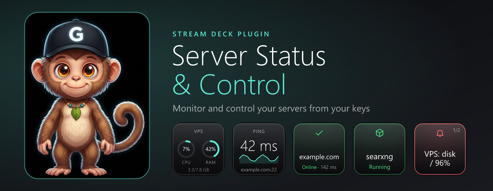
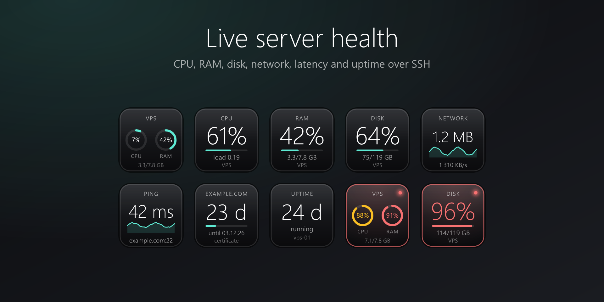
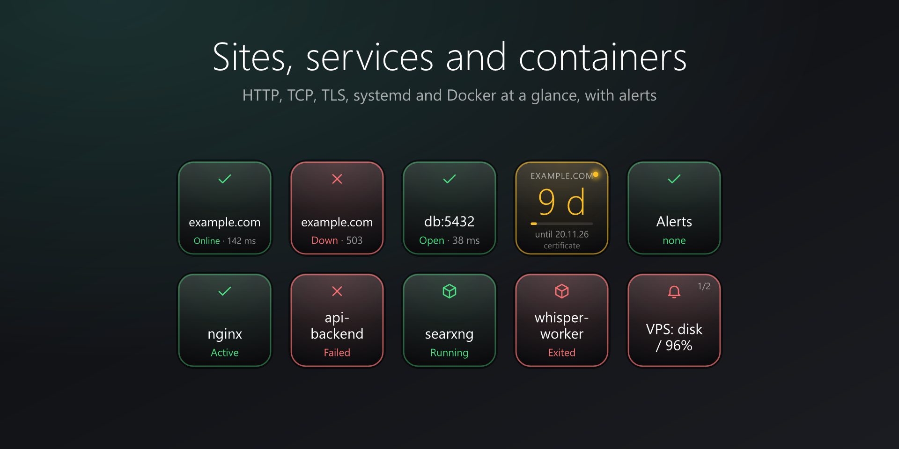
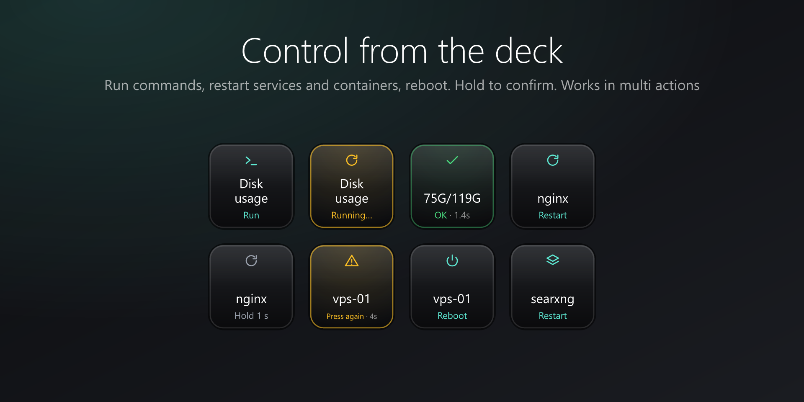
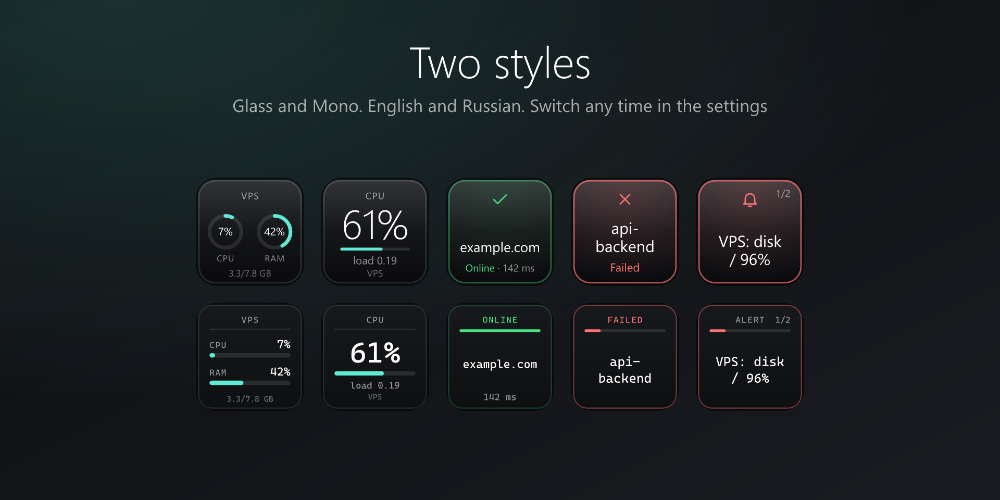

<div align="center">



<br>

🌐 [English](README.md) &nbsp;·&nbsp; **Русский**

<br>

[](LICENSE)
[](https://www.elgato.com/stream-deck)
[](#требования)
[](#приватность-и-безопасность)

**Видите свои серверы с одного взгляда. Чините их одним нажатием.**<br>
CPU, RAM, диск, сеть, сайты, TLS-сертификаты, службы, Docker, тревоги и безопасное управление, прямо на кнопках.

[Быстрый старт](#быстрый-старт) · [Действия](#действия) · [Безопасность](#приватность-и-безопасность) · [Проблемы](#решение-проблем) · [Issues](https://github.com/TheGudwinn/streamdeck-server-status-control/issues)

</div>

---

## Зачем этот плагин

<table>
<tr>
<td width="50%" valign="top">

### 👀 Мониторинг
- CPU, RAM, swap, load, диск, сеть, аптайм
- Проверки сайтов, портов и TLS-сертификатов
- Службы systemd и Docker-контейнеры
- Один ключ **Alert Hub**: мигает, пока вы не примете тревогу

</td>
<td width="50%" valign="top">

### 🛠 Управление
- Запуск своих команд и готовых пресетов
- Перезапуск, запуск, остановка служб и контейнеров
- Перезагрузка nginx **после проверки конфига**
- Reboot с двойным подтверждением
- Всё работает внутри **мультидействий**

</td>
</tr>
<tr>
<td valign="top">

### 🔌 Ничего не ставится на сервер
Используется `ssh`, который уже есть на вашем компьютере, и ваш `~/.ssh/config`. Без агентов, аккаунтов и API-ключей.

</td>
<td valign="top">

### 🎨 Красиво и читаемо
Два стиля кнопок (**Стекло** и **Моно**), английский и русский языки, всё читается с одного взгляда.

</td>
</tr>
</table>

## Скриншоты

<table>
<tr>
<td></td>
<td></td>
</tr>
<tr>
<td></td>
<td></td>
</tr>
</table>

## Действия

| | Действие | Что делает |
|:-:|---|---|
| 🖥 | **Host Overview** | CPU и RAM сервера на одной кнопке |
| 📊 | **Metric** | CPU, RAM, swap, load, диск, сеть, аптайм, где нужно с графиком |
| 📡 | **Latency** | время TCP-соединения с историей |
| 🌐 | **HTTP Check** | код ответа, время, слово на странице (по желанию) |
| 🔌 | **TCP Port** | открыт ли порт |
| 🔒 | **TLS Expiry** | сколько дней до окончания сертификата |
| ⚙️ | **systemd Unit** | состояние службы, по желанию перезапуск удержанием |
| 📦 | **Docker Container** | состояние контейнера, по желанию перезапуск удержанием |
| 🔔 | **Alert Hub** / **Acknowledge** | общий ключ тревог и ключ для их принятия |
| ⌨️ | **Run Command** | команда или пресет, результат на кнопке |
| ⏻ | **Power** | перезагрузка или выключение: удержание 1,5 с, затем второе нажатие |
| 🔄 | **Service Control** | `systemctl` restart / start / stop / reload |
| 🧱 | **Docker Control** | `docker` restart / start / stop |

> HTTP Check, TCP Port, Latency и TLS Expiry работают без SSH. Всё остальное требует SSH-доступа к Linux-серверу.

### Пресеты команд

Аптайм · Занятое место на диске · Топ процесс · Ошибки за 10 минут · Проверка nginx · **Перезагрузка nginx** (сначала проверяет конфиг) · Запущено контейнеров Docker · Очистка кэша

## Быстрый старт

### Требования

- Windows 10 или новее и Stream Deck 7.1 или новее (macOS не проверялся)
- Для серверных функций: вход по SSH-ключу на Linux-сервер. Для systemd и Docker они должны быть на сервере

### Установка

- **Elgato Marketplace:** карточка готовится, ссылка появится здесь
- **Из исходников:** `npm install && npm run build`, затем `streamdeck pack com.guddion.server-status.sdPlugin -o dist` и двойной клик по файлу `.streamDeckPlugin` (нужен [Stream Deck CLI](https://docs.elgato.com/streamdeck/cli/intro))

### Настройка сервера

1. **Используйте вход по ключу.** Плагин никогда не спрашивает пароли. Проверьте в терминале: `ssh user@your-server`
2. **Один раз примите ключ хоста.** Подключитесь из терминала, чтобы ключ сервера сохранился. Пока этого нет, кнопка показывает *Offline*
3. **Рекомендуется:** опишите сервер в `~/.ssh/config`, и он появится в списке **Server**:

   ```text
   Host my-vps
     HostName 203.0.113.10
     User root
     IdentityFile ~/.ssh/my_vps_key
   ```

   Без записи в конфиге введите `user@host` в **Custom address**, а путь к ключу в **SSH key**.
4. Перетащите действие на кнопку и выберите сервер. Готово

## Приватность и безопасность

- **Без телеметрии, аккаунтов и API-ключей.** Плагин общается только с серверами, которые вы указали. Страница настроек загружает официальную библиотеку [sdpi-components](https://sdpi-components.dev), больше ничего с компьютера не уходит
- **Мониторинг только читает:** `/proc`, `df`, `systemctl is-active`, `docker ps`
- **Рискованные действия защищены:** удержание, двойное нажатие или удержание плюс второе нажатие (Power). Внутри **мультидействия** они выполняются сразу, потому что цепочку собрали вы сами
- **Опасные команды заблокированы** (`rm -rf /`, `mkfs`, `dd` на устройство, `reboot`, fork bomb…), пока вы не отметите *Dangerous commands* на этой кнопке
- **Команды от root** выполняются через `sudo -n` (без запроса пароля). Используйте ключ с нужными правами

## Решение проблем

<details>
<summary><b>Кнопка показывает «Offline · SSH»</b></summary>

Выполните `ssh user@host` в терминале. Проверьте ключ и адрес, один раз примите ключ хоста. Плагин работает с `BatchMode=yes` и не может отвечать на вопросы.
</details>

<details>
<summary><b>«Permission denied»</b></summary>

Ключ не добавлен на сервер или защищён парольной фразой. Используйте `ssh-agent` или ключ без парольной фразы.
</details>

<details>
<summary><b>Кнопка Docker пишет «No Docker»</b></summary>

Пользователь SSH не может выполнить `docker ps`. Добавьте его в группу `docker` или используйте root.
</details>

<details>
<summary><b>Кнопка службы показывает «inactive», хотя служба работает</b></summary>

Укажите точное имя юнита, например `nginx.service`.
</details>

<details>
<summary><b>На странице настроек нет серверов</b></summary>

В `~/.ssh/config` нет именованных записей `Host`. Используйте **Custom address** и **SSH key**.
</details>

## Разработка

```bash
npm install
npm run build                    # сборка в com.guddion.server-status.sdPlugin/bin
npm run watch                    # пересборка и перезагрузка при изменениях (нужен `streamdeck dev`)
npm test                         # юнит-тесты
node scripts/gen-icons.mjs       # перегенерировать иконки
node scripts/gen-listing.mjs     # перегенерировать картинки для Marketplace
node scripts/gen-banner.mjs      # перегенерировать этот баннер
```

План развития и идеи: [docs/TOOLKIT.md](docs/TOOLKIT.md). Сообщения об ошибках и pull request'ы приветствуются.

## Лицензия

[MIT](LICENSE) © 2026 Guddion

## Использование ИИ

Создано с помощью ИИ-ассистента (Claude от Anthropic) по заданию автора и под его проверкой. Маскот — собственный персонаж автора.
